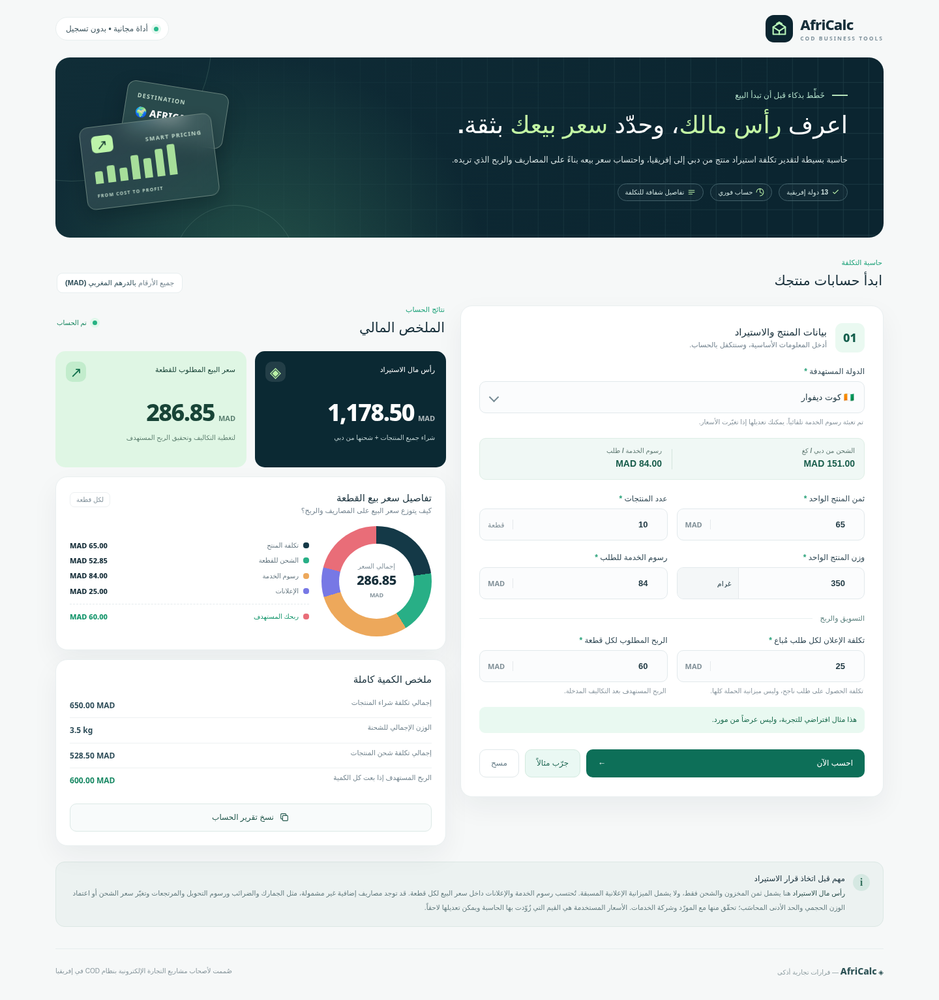

# AfriCalc 🌍 — حاسبة الاستيراد وسعر البيع في إفريقيا

تطبيق ويب مجاني وبسيط باللغة العربية للتجار الذين يعملون بنظام **الدفع عند الاستلام (COD)** في الأسواق الإفريقية. يساعدك على حساب **رأس مال الاستيراد** و**سعر البيع المطلوب** اعتماداً على رسوم الخدمة والشحن من دبي إلى الدولة المختارة.

 

## معاينة التصميم



[معاينة نسخة الهاتف](screenshots/mobile.png)

## المزايا

- اختيار الدولة من بين 13 دولة إفريقية.
- تعبئة رسوم الخدمة وسعر الشحن (MAD/kg) وفق بيانات قائمة الأسعار.
- إمكانية تعديل رسوم الخدمة يدوياً، خاصة عند تغير الأسعار.
- إدخال ثمن المنتج، عدد القطع، وزن القطعة بالغرام أو الكيلوغرام، تكلفة الإعلانات لكل طلب مُباع، والربح المطلوب لكل قطعة.
- حساب مباشر لرأس مال استيراد المخزون وسعر البيع للقطعة، مع تفصيل كامل للتكاليف.
- نسخ تقرير الحساب، وتجربة مثال توضيحي.
- واجهة متجاوبة مع الهاتف والكمبيوتر، باللغة العربية ومن اليمين إلى اليسار.
- لا يحتاج إلى خادم أو قاعدة بيانات أو حساب مستخدم.

## طريقة الحساب

أولاً نحول الوزن إلى الكيلوغرام.

```text
وزن الشحنة (كغ) = عدد القطع × وزن القطعة (كغ)
شحن القطعة (MAD) = وزن القطعة (كغ) × الشحن لكل كيلوغرام
إجمالي شراء المخزون = ثمن القطعة × عدد القطع
إجمالي الشحن = وزن الشحنة (كغ) × سعر الشحن لكل كيلوغرام
رأس مال الاستيراد = إجمالي شراء المخزون + إجمالي الشحن
سعر بيع القطعة = ثمن القطعة + شحن القطعة + رسوم الخدمة لكل طلب
              + تكلفة الإعلان لكل طلب مُباع + الربح المطلوب لكل قطعة
الربح المستهدف للكمية كاملة = الربح المطلوب للقطعة × عدد القطع
```

**تنبيه:** «رأس مال الاستيراد» في التطبيق يشمل شراء البضاعة وشحنها فقط كما في المطلوب، ولا يشمل المال الذي قد تحتاجه مقدماً لتشغيل الإعلانات أو رسوم أخرى. النموذج يفترض أن كل قطعة ستُباع ويُسلَّم طلبها بنجاح للحصول على الربح الإجمالي الموضح. لا يقدّر الخسائر الناتجة عن الإلغاءات أو المرتجعات، ولا الجمارك/الضرائب أو حدود وزن الشحن القابل للفوترة.

## مثال

إذا اخترت **كوت ديفوار** وكانت:

- تكلفة القطعة: 65 MAD
- عدد القطع: 10
- وزن القطعة: 350 غرام
- تكلفة الإعلان لكل طلب مباع: 25 MAD
- الربح المستهدف لكل قطعة: 60 MAD
- رسوم الخدمة: 84 MAD
- الشحن: 151 MAD / kg

فإن:

- شحن القطعة = 52.85 MAD
- شحن 10 قطع = 528.50 MAD
- تكلفة شراء المنتجات = 650.00 MAD
- **رأس مال الاستيراد = 1,178.50 MAD**
- **سعر بيع القطعة = 286.85 MAD**

## التشغيل على جهازك

افتح ملف `index.html` في المتصفح. يمكنك أيضاً استخدام إضافة Live Server إن رغبت.

## رفعه إلى GitHub ونشره مجاناً

1. أنشئ مستودع GitHub جديداً واجعله **Public** (مثلاً `africalc`).
2. ارفع محتويات هذا المجلد إلى **جذر** المستودع (وليس ملف ZIP وحده): `index.html` و`styles.css` و`script.js` و`favicon.svg` و`README.md`.
3. من المستودع افتح **Settings → Pages**.
4. في **Build and deployment** اختر **Deploy from a branch**، ثم الفرع **main** والمجلد **/(root)** ثم **Save**.
5. سيظهر رابط موقعك عادة على الصيغة `https://USERNAME.github.io/africalc/` بعد إكمال النشر.

لا يلزم شراء دومين، ويمكن مشاركة الرابط مع أي شخص.

## تعديل الأسعار

داخل `script.js` ابحث عن `COUNTRIES`. لكل دولة هذه الخصائص:

```js
{ code: 'CI', name: '🇨🇮 كوت ديفوار', service: 84, shipping: 151 }
```

- `service`: رسوم الخدمة لكل طلب ناجح بالدرهم المغربي.
- `shipping`: تكلفة شحن كل كيلوغرام من دبي إلى البلد بالدرهم المغربي.
- **السنغال:** تكلفة الشحن معروفة (`134 MAD/kg`) لكن رسوم الخدمة لم تُقدّم في البيانات الأصلية؛ لذلك يُطلب إدخالها يدوياً بدلاً من استخدام رقم مخترع.

هذه الأسعار **قيم مرجعية ثابتة** وفق البيانات المزوَّدة للمشروع، وليست معلومات محدثة تلقائياً. راجعها قبل العمل على شحنة حقيقية.

## التقنيات

HTML + CSS + JavaScript فقط، بلا مكتبات أو تبعيات تشغيلية. استخدام خط Cairo من Google Fonts اختياري؛ عند عدم الاتصال بالإنترنت تُستخدم خطوط النظام الاحتياطية.

## الترخيص

[MIT](LICENSE) — يمكن الاستخدام والتعديل وإعادة النشر.
